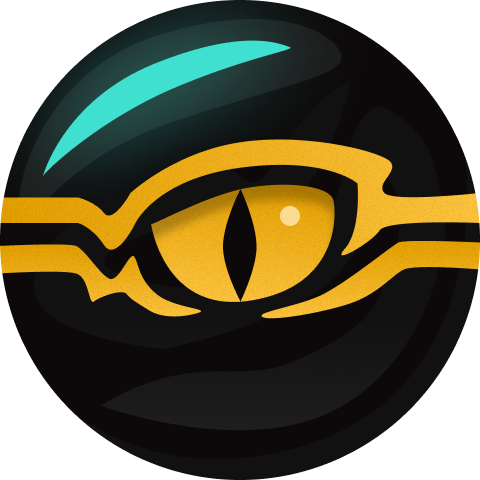

# Smokey Mirror



**Your files. A little more private.**

A small Windows file encryption utility written in Go. Choose a file, choose a
passphrase or key file, and save an encrypted copy. No account, cloud service,
background process, or browser runtime.

[Русская инструкция](docs/README.ru.md) · [Security model](SECURITY.md) · [Architecture](docs/ARCHITECTURE.md) · [Roadmap](docs/ROADMAP.md)

## What it does

- Native desktop window, drag and drop, progress, cancellation, and a result shortcut.
- Hidden passphrase prompts in PowerShell and cmd, or a reusable generated key file.
- Explorer **Encrypt with Smokey Mirror** and **Decrypt with Smokey Mirror** actions.
- Streaming encryption for large files. Originals are always kept.
- No overwrites. Failed or cancelled operations remove temporary output.
- Standard binary [age files](https://age-encryption.org/), with a `.smoke` extension.

The desktop app suggests a numbered filename when the original destination
already exists. The CLI keeps deterministic names and reports a conflict; use
`--out` to choose another destination.

## Start here

**Portable:** open `dist/smokey.exe`. This one executable includes the GUI and
CLI. It does not register anything until you explicitly run `smokey install`.
The Windows console subsystem keeps normal shell waiting, pipes, and exit codes
working; a console may briefly appear when opening the GUI from Explorer.

**Installed:** open `dist/SmokeyMirror-Setup.exe`. Installation is per-user,
under `%LOCALAPPDATA%\Programs\Smokey Mirror`, without administrator privileges.
It adds a Start menu shortcut, Explorer actions, an uninstall entry in Windows
Settings, and the `smokey` command to the user PATH. Open a new terminal afterward.
On Windows 11 the classic Explorer actions are under **Show more options**.

The release targets Windows 10/11 x64. Binaries are currently unsigned.
The encryption core and CLI can also be built on Linux/macOS; GUI and system
integration are Windows-only. Close the app before uninstalling. For this initial
release, uninstall an existing version before reinstalling; keys and user files
are not removed.

## Commands

```powershell
# A hidden prompt asks for a passphrase and confirmation.
.\smokey.exe encrypt "C:\Files\budget.xlsx"

# The original still exists, so select a new destination.
.\smokey.exe decrypt "C:\Files\budget.xlsx.smoke" --out "C:\Files\restored.xlsx"

# Generate once, then reuse the key for any number of files.
.\smokey.exe keygen "E:\Private\personal.smokey-key"
.\smokey.exe encrypt "C:\Files\photo.jpg" --key-file "E:\Private\personal.smokey-key"
.\smokey.exe decrypt "C:\Files\photo.jpg.smoke" --key-file "E:\Private\personal.smokey-key" -o "C:\Files\restored.jpg"

.\smokey.exe gui --decrypt "C:\Files\photo.jpg.smoke"
.\smokey.exe install
.\smokey.exe uninstall
.\smokey.exe --help
```

Flags work before or after the input filename. Use `--` for filenames beginning
with a dash. Exit status is `0` on success, `1` on errors or cancellation.
Ctrl+C cancels CLI operations. The GUI cancels cooperatively and keeps the
window open until temporary files have been cleaned up.

Automation can pipe a single UTF-8 passphrase line using `--password-stdin`.
One trailing LF or CRLF is removed; other whitespace is preserved. Input is
limited to 4096 bytes. There is deliberately no `--password` argument, to avoid
putting secrets in command history and process arguments. Prefer hidden prompts
for interactive use and secret-store output for automation; do not put real
passphrases directly into shell commands.

## Two ways to unlock

**Passphrase:** at least 12 characters when encrypting. Use a long, unpredictable
phrase, not a quotation or a reused password. Encryption uses age's scrypt
recipient at work factor 18 (about 256 MiB for key derivation).

**Key file:** generated by Smokey Mirror or `age-keygen`, containing one private
X25519 identity. This is a random cryptographic key, not an arbitrary document
or photograph. No passphrase is needed in this mode. Anyone with a copy can
decrypt the files. Back it up separately from the encrypted data.

There is no password reset or recovery backdoor. Encryption protects file
contents; filenames, sizes, and the presence of encrypted files remain visible.
See [SECURITY.md](SECURITY.md) for temporary-file, memory, and filesystem limits.

## Build and verify

Go 1.26+ is required. `go.mod` pins the release toolchain; Go can download it
automatically. No C compiler or third-party installer compiler is needed.

```powershell
go test ./...
go vet ./...
.\scripts\build.ps1
```

Outputs: `dist/smokey.exe`, `dist/SmokeyMirror-Setup.exe`, `dist/SHA256SUMS.txt`,
and `dist/build-info.txt`. Run `scripts/build.ps1 -Resources` after editing the
icon generator or manifest. Windows resource objects are committed so ordinary
builds need no resource generator. The setup payload is generated and ignored
by Git; the setup package uses the `installer` build tag.

```powershell
go run golang.org/x/vuln/cmd/govulncheck@v1.9.0 ./...
.\scripts\smoke.ps1
```

CI checks the portable core on Linux and Windows, uses the race detector on
Linux, and builds both Windows executables. Installer tests use temporary
directories and an isolated HKCU test subtree. Tests cover chunk boundaries,
Unicode paths, invalid credentials, tampering, truncation, trailing bytes,
cancellation, concurrent destination creation, and registration rollback.

`scripts/install-smoke.ps1` additionally tests a real per-user install and
uninstall cycle. It refuses to run over an existing installation and restores
the original PATH. Run it only when intentionally testing Windows integration.

## Scope

One regular file per operation. Archive folders first. Labels and batch
decryption are planned separately, with the same encryption engine and an
explicit user-selected set of files. This version does not scan or index your
disk. See the [roadmap](docs/ROADMAP.md).

MIT licensed. Dependencies retain their own licenses; see
[THIRD_PARTY_NOTICES.md](THIRD_PARTY_NOTICES.md).
The same license texts are embedded in the portable executable and available
with `smokey licenses`. See [validation notes](docs/VALIDATION.md) for the checks
performed on the initial release.
